<!-- ╭──────────────────────────────────────────────────────────────╮ -->
<!-- │  check-pre-lancamento · por Paulo Sérgio Dantas              │ -->
<!-- │  github.com/dantaspaulo/check-pre-lancamento                 │ -->
<!-- │  Licença de Uso com Atribuição v1.0 · impressão CPL-PSD-2026 │ -->
<!-- │  Cartões animados: assets/gerar.py                           │ -->
<!-- ╰──────────────────────────────────────────────────────────────╯ -->

<div align="center">


<a href="#-instalar-em-1-minuto">
  
</a>

<br/>

<a href="https://github.com/dantaspaulo/check-pre-lancamento/releases/latest/download/check-pre-lancamento.zip"></a>
<a href="#claude-code"></a>
<a href="#claudeai-e-app-do-claude"></a>
<a href="#openai-codex"></a>
<a href="#cursor-copilot-gemini-e-outros"></a>
<a href="#lovable-bolt-e-replit"></a>

<a href="https://github.com/dantaspaulo/check-pre-lancamento/releases/latest"></a>
<a href="https://github.com/dantaspaulo/check-pre-lancamento/actions/workflows/ci.yml"></a>
<a href="LICENSE"></a>


<br/><br/>

**Antes de divulgar o link, deixe a IA fazer o que um auditor faria:<br/>procurar chave exposta, banco aberto, rota sem login, e-mail que não chega e conta que pode estourar.**

<sub>Uma skill para Claude, Codex, Cursor, Copilot, Gemini e outros agentes. Lê o seu código e o seu site e entrega um relatório com veredito, nota e as correções prontas para o próprio agente aplicar.</sub>

<br/><br/>

<picture>
  <source media="(max-width: 700px)" srcset="assets/numeros-celular.svg" />
  
</picture>

</div>

<br/>

<div align="center">

## 🧭 Como funciona

<picture>
  <source media="(max-width: 700px)" srcset="assets/fluxo-celular.svg" />
  
</picture>

</div>

1. **Varredura.** Um scanner (Python, sem instalar nada) lê o código e o histórico do git e, se você passar a URL, o site publicado. Ele procura chaves secretas, regras do banco, rotas, configurações e dependências vulneráveis.
2. **Revisão.** O agente abre cada achado, descarta falso positivo e revisa rota a rota o que scanner nenhum resolve sozinho: quem pode ler o quê, o que entra sem validação, o que sai a mais.
3. **Relatório.** O `check-report/RELATORIO.md` traz o veredito (🔴 não lance · 🟡 ajuste antes · 🟢 pode lançar), a nota de segurança, a nota de prontidão e cada problema com arquivo:linha, risco e correção.
4. **Correção.** O `check-report/CORRECOES.md` é o plano para o agente: uma task por vez, com prompt pronto, critério de aceite e commit. Você diz *"aplique as correções"* e acompanha.

<br/>

<div align="center">

## ✅ O que ela checa

<picture>
  <source media="(max-width: 700px)" srcset="assets/checagens-celular.svg" />
  
</picture>

<br/>

<picture>
  <source media="(max-width: 700px)" srcset="assets/prontidao-celular.svg" />
  
</picture>

</div>

<details>
<summary><b>📋 O que cada item procura, em uma linha</b></summary>

<br/>

| # | Segurança | O que procura |
|---|---|---|
| 01 | Esconder API Keys | chave da OpenAI, Anthropic, Stripe… no código, no `.env` com prefixo público (`NEXT_PUBLIC_`, `VITE_`), no `next.config` ou no JavaScript publicado |
| 02 | Limpar secrets do Git | `.env`, `.pem` e service account versionados, e chaves que ficaram no histórico |
| 03 | Usar apenas Public Key no DB | service role, `sb_secret_`, `firebase-admin` ou driver de banco no navegador |
| 04 | Ativar RLS | tabela sem RLS, policy `using (true)`, regra do Firebase aberta, PocketBase/Appwrite públicos |
| 05 | Criptografia de dados | CPF, saúde, tokens de terceiros em texto puro; cartão guardado; cripto fraca |
| 06 | Auth server-side | rota, Server Action, controller ou função sem checar a sessão no servidor |
| 07 | Restringir acessos | usuário A lendo dados do B pelo id na URL, papel vindo do cliente, CORS aberto |
| 08 | Bloquear Mass Assignment | o body inteiro indo para o banco (`$request->all()`, `data: body`, `@RequestBody Entity`) |
| 09 | Proteger cookies | token em `localStorage`, cookie sem `HttpOnly`/`Secure`, CSRF desligado |
| 10 | Hash nas senhas | MD5/SHA em senha, texto puro, bcrypt fraco, senha mínima curta |
| 11 | Rate limit | login, cadastro, IA, e-mail e SMS sem limite |
| 12 | Bot protection | cadastro e formulários sem captcha, ou captcha sem verificação no servidor |
| 13 | Queries parametrizadas | SQL montado com string em JS, PHP, Python, Ruby, Java, C# e Go; NoSQL com objeto do request |
| 14 | Validação dos inputs | rota sem schema, XSS (`dangerouslySetInnerHTML`, `v-html`, `{!! !!}`), SSRF, path traversal |
| 15 | Evitar vazamento de conteúdo | debug ligado, stack trace na resposta, source maps, Actuator aberto, `/.env` público |
| 16 | Restringir uploads | sem limite de tamanho, sem checar tipo, nome original no caminho, bucket público |
| 17 | Limitar respostas de API | objeto de usuário inteiro (com hash de senha), listagem sem paginação, GraphQL sem limite |
| 18 | Security headers | CSP, HSTS, X-Frame-Options, nosniff, Referrer-Policy e Permissions-Policy |
| 19 | Forçar HTTPS | HTTP sem redirect, TLS desligado, app mobile aceitando tráfego sem HTTPS |
| 20 | Scan de dependências | `npm audit`, `pip-audit`, `composer audit`, `osv-scanner`, `govulncheck`; Next.js vulnerável |

| # | Prontidão | O que procura |
|---|---|---|
| P01 | Configuração de produção | variável não documentada, `localhost` no código, chave de teste em produção |
| P02 | Erros e logs monitorados | Sentry ou equivalente, tela de erro amigável |
| P03 | Backup e recuperação | backup automático, cópia fora do provedor, restauração testada |
| P04 | Deploy, migrations e rollback | migrations versionadas, CI, testes, caminho de volta |
| P05 | Uptime e alertas | health check, monitor externo, certificado vencendo |
| P06 | E-mail e domínio | SMTP próprio (o padrão do Supabase é só para teste), SPF, DKIM e DMARC |
| P07 | LGPD, privacidade e termos | política, termos, consentimento de cookies, exclusão de conta |
| P08 | SEO e compartilhamento | título do template ("Lovable App"), `noindex` esquecido, og:image, sitemap |
| P09 | Performance e experiência | imagens pesadas, JS grande, viewport, compressão, página 404 |
| P10 | Custos e limites de gasto | IA sem `max_tokens`, sem teto de gasto na nuvem e na API |

</details>

<br/>

<div align="center">

## 🚀 Instalar em 1 minuto

**Escolha onde você usa IA.** Todas as opções instalam a mesma skill, direto deste repositório.

</div>

### Claude Code

<sub>Recomendado: ele lê o projeto inteiro, roda o scanner e já aplica as correções.</sub>

**Como plugin** (atualiza com um comando). Dentro do Claude Code:

```text
/plugin marketplace add dantaspaulo/check-pre-lancamento
/plugin install check-pre-lancamento@check-pre-lancamento
```

**Ou como skill pessoal** (no terminal):

```bash
git clone https://github.com/dantaspaulo/check-pre-lancamento.git
cp -R check-pre-lancamento/skills/check-pre-lancamento ~/.claude/skills/
```

Depois, na pasta do projeto: `/check-pre-lancamento` ou *"faz o check pré-lançamento"*. Como plugin, o comando é `/check-pre-lancamento:check-pre-lancamento`. Para atualizar o plugin: `/plugin marketplace update check-pre-lancamento`.

### Claude.ai e app do Claude

<sub>Web, desktop e celular. Bom para quem não programa: você anexa o projeto e conversa.</sub>

1. Em **Configurações → Capacidades** (*Settings → Capabilities*), ligue **Execução de código e criação de arquivos** (*Code execution and file creation*).
2. Baixe o **[check-pre-lancamento.zip](https://github.com/dantaspaulo/check-pre-lancamento/releases/latest/download/check-pre-lancamento.zip)**. Não use o botão "Download ZIP" do GitHub: ele traz o repositório inteiro, e não só a skill.
3. Em **Personalizar → Skills → + → Enviar uma skill** (*Customize → Skills → + → Upload a skill*), escolha o `.zip`.
4. Numa conversa nova, anexe o projeto zipado (ou conecte o repositório do GitHub) e peça: *"faz o check pré-lançamento"*. Passe também a URL do site publicado.

<sub>O nome dos menus pode variar um pouco com a versão do app.</sub>

### OpenAI Codex

<sub>CLI, extensão de IDE e app.</sub>

```text
$skill-installer install https://github.com/dantaspaulo/check-pre-lancamento/tree/main/skills/check-pre-lancamento
```

Ou copie a pasta `skills/check-pre-lancamento` para `~/.agents/skills/` (no seu usuário) ou `.agents/skills/` (no projeto). Para usar: `$check-pre-lancamento`, ou peça o check. Se não aparecer, reinicie o Codex.

### Cursor, Copilot, Gemini e outros

**Um comando para qualquer agente** (Node 22.20+). Ele pergunta em quais ferramentas instalar:

```bash
npx skills add dantaspaulo/check-pre-lancamento
```

**Ou copie a pasta** `skills/check-pre-lancamento` para o lugar que a sua ferramenta lê:

| Ferramenta | No projeto | No seu usuário | Para chamar |
|---|---|---|---|
| **Cursor** | `.cursor/skills/` ou `.agents/skills/` | `~/.cursor/skills/` (também lê `~/.claude/skills/`) | `/check-pre-lancamento` |
| **GitHub Copilot** (VS Code e CLI) | `.github/skills/` | `~/.copilot/skills/` | `/check-pre-lancamento` |
| **Gemini CLI** | `.gemini/skills/` ou `.agents/skills/` | `~/.gemini/skills/` | automático, ou `/skills list` |
| **Antigravity** | `.agents/skills/` | `~/.gemini/config/skills/` | `/check-pre-lancamento` |
| **Windsurf** | `.windsurf/skills/` ou `.agents/skills/` | `~/.codeium/windsurf/skills/` | `@check-pre-lancamento` |
| **OpenCode** | `.opencode/skills/` ou `.agents/skills/` | `~/.config/opencode/skills/` | automático |
| **Kiro** | `.kiro/skills/` | `~/.kiro/skills/` | automático |
| **Amp / Goose** | `.agents/skills/` | `~/.agents/skills/` | automático |

<sub>💡 **`.agents/skills/` é a pasta universal**: Codex, Cursor, Copilot, Gemini, Antigravity, Windsurf, OpenCode, Amp e Goose leem dela.</sub>

<details>
<summary><b>Instaladores de cada ferramenta</b></summary>

<br/>

```bash
# GitHub Copilot (gh 2.90 ou mais novo)
gh skill install dantaspaulo/check-pre-lancamento check-pre-lancamento

# Gemini CLI
gemini skills install https://github.com/dantaspaulo/check-pre-lancamento.git --path skills/check-pre-lancamento

# npx skills, escolhendo as ferramentas e instalando no seu usuário
npx skills add dantaspaulo/check-pre-lancamento -g -a claude-code -a codex -a cursor -a github-copilot
```

</details>

### Lovable, Bolt e Replit

<sub>Essas plataformas importam skills, mas não rodam os scripts Python. A skill tem um modo manual: o agente segue as mesmas checagens lendo o código.</sub>

- **Lovable:** Configurações do workspace → **Skills** → Adicionar → **Importar do GitHub**, com o endereço `https://github.com/dantaspaulo/check-pre-lancamento/tree/main/skills/check-pre-lancamento`. Ou envie o `.zip`.
- **Bolt:** Configurações → **Skills** → Adicionar skill → **Do GitHub**, com o mesmo endereço.
- **Replit:** no Agent, **+** → **Usar uma skill** → cole o endereço → Importar.

<sub>Para a varredura completa (histórico do git, sondagem do banco, auditoria de dependências), sincronize o projeto com o GitHub e rode o check no Claude Code ou no Codex.</sub>

### Sem agente nenhum

O scanner roda sozinho, inclusive no CI:

```bash
python3 skills/check-pre-lancamento/scripts/scan.py /caminho/do/projeto
python3 skills/check-pre-lancamento/scripts/check_url.py https://meuapp.com.br
```

<sub>Python 3.8+ só com a biblioteca padrão. No Windows, use `python` ou `py -3` no lugar de `python3`. Git, npm, pip-audit, composer, osv-scanner e govulncheck são usados se existirem.</sub>

<br/>

<div align="center">

## 💬 Como usar

</div>

| Você diz | O que acontece |
|---|---|
| *"faz o check pré-lançamento"* ou `/check-pre-lancamento` | as 20 checagens + os 10 itens de prontidão no projeto aberto |
| *"checa o projeto e o site https://meuapp.com.br"* | também headers, HTTPS, cookies, CORS, `/.env` exposto, JavaScript público, SEO e DNS de e-mail |
| *"pode testar se o banco está aberto, o app é meu"* | conta quantas linhas do Supabase/Firebase um visitante lê sem login (só leitura) |
| *"checa só o RLS"* · *"só os segredos"* · *"só a prontidão"* | só o que você pediu |
| *"ignora a pasta arquivos-locais"* | tira a pasta das regras de código (o scanner já ignora o `.gitignore`, `docs/` e `examples/`) |
| *"aplique as correções do CORRECOES.md"* | o agente corrige uma por vez, com build, teste e commit por task |
| *"roda o PA04"* | o agente segue um dos [prompts prontos](PROMPTS.md) (o PA04 revisa as permissões do Supabase) |

O resultado fica em `check-report/`:

```text
🔴 Veredito: NÃO LANCE AINDA
Nota de segurança: 49/100 · Nota de prontidão: 60/100

| #   | Item                 | Status     | Severidade | O que encontrei                                          |
|-----|----------------------|------------|------------|----------------------------------------------------------|
| 01  | Esconder API Keys    | ❌ FALHA   | 🔴 CRÍTICO | chave da OpenAI no bundle via VITE_OPENAI_API_KEY        |
| 04  | Ativar RLS           | ❌ FALHA   | 🔴 CRÍTICO | agendamentos sem RLS: 1.204 linhas visíveis sem login    |
| 06  | Auth server-side     | ⚠️ ATENÇÃO | 🟠 ALTO    | Edge Function lembrete com verify_jwt = false            |
| P06 | E-mail e domínio     | ❌ FALHA   | 🟠 ALTO    | confirmação pelo SMTP padrão do Supabase; sem DMARC      |
```

📄 **Veja o exemplo completo** (app fictício feito na Lovable): [RELATORIO.md](exemplos/RELATORIO.md) · [CORRECOES.md](exemplos/CORRECOES.md)

<sub>No seu projeto, o relatório fica fora do git (`.git/info/exclude`) porque mapeia as falhas do app.</sub>

<br/>

<div align="center">

## 🪄 Depois da análise: prompts prontos

</div>

O relatório termina com os prompts que combinam com o que foi achado. Copie, cole no seu agente aberto na pasta do projeto, e ele faz o próximo passo do jeito seguro. A lista completa está em **[PROMPTS.md](PROMPTS.md)**:

| | Para quê |
|---|---|
| **PA01** | resolver hoje só o que impede o lançamento |
| **PA02** | trocar as chaves que vazaram, sem nunca mostrar a chave no chat |
| **PA03** | aplicar o `CORRECOES.md` na ordem, uma task por vez, com prova |
| **PA04** | revisar as permissões do Supabase tabela por tabela, sem reabrir funções internas |
| **PA05** | deixar uma regra fixa para a IA não reabrir o banco na próxima tabela |
| **PA06** | provar com teste que um usuário não vê dado de outro |
| **PA07** | fechar o cadastro: captcha, e-mail confirmado e senha forte |
| **PA08** | escrever Termos de Uso e Política de Privacidade a partir do que o app coleta |
| **PA09** a **PA12** | headers sem quebrar o site, dependências, backup testado, erro e queda com alerta |
| **PA13** a **PA15** | checklist do dia do lançamento, conferir de novo comparando, explicar para quem não é técnico |

<br/>

<div align="center">

## 🧩 Funciona com


<br/>

<br/>


<br/><br/>


<sub>Para cada stack há um guia com onde olhar e como corrigir: [front e mobile](skills/check-pre-lancamento/references/stacks/front-e-mobile.md) · [back-end JS](skills/check-pre-lancamento/references/stacks/back-js.md) · [PHP, Python e Ruby](skills/check-pre-lancamento/references/stacks/back-php-python-ruby.md) · [Java, .NET e Go](skills/check-pre-lancamento/references/stacks/back-java-dotnet-go.md) · [Supabase, Firebase e cia.](skills/check-pre-lancamento/references/stacks/baas.md) · [plataformas](skills/check-pre-lancamento/references/plataformas.md)</sub>

</div>

<br/>

<div align="center">

## 🛡️ Segura para usar no seu código

</div>

- **Roda onde o seu agente roda:** no seu computador (Claude Code, Codex, Cursor) ou na sandbox do Claude (claude.ai). Os scripts não mandam o seu código para lugar nenhum. Sem telemetria. A rede só é usada para:
  - a auditoria de dependências (`npm audit` e afins);
  - o site que **você** indicar;
  - a consulta de DNS do seu domínio.
- **Não altera nada durante a auditoria.** Escreve só a pasta `check-report/`. Correção, só se você pedir.
- **Nunca mostra uma chave inteira.** O relatório, o JSON e o chat mostram só o começo da chave (`sk-pro…****`). Para ver o conteúdo de um arquivo, o agente usa um leitor que já mascara os valores.
- **Teste de site é educado.** Só requisições normais, sem ataque, sem força bruta, só no seu domínio. A sondagem do banco é opcional, só lê e só roda com o seu OK.
- **Código aberto para leitura.** Tudo em Python padrão, sem dependências, com [testes](tests/run_tests.py) que montam 15 projetos de exemplo a cada mudança.

<br/>

<details>
<summary><b>❓ Perguntas frequentes</b></summary>

<br/>

**Substitui um pentest?**
Não. É triagem automatizada mais revisão de código por IA. Pega a maioria dos erros que derrubam app feito rápido. Para app com dinheiro, saúde ou dado sensível em escala, contrate também um teste profissional.

**Fiz o app no Lovable/Bolt e não sei programar. Serve?**
Serve. Pelo claude.ai: anexe o projeto (ou conecte o GitHub), passe a URL e peça o check. O relatório explica cada problema pelo efeito ("qualquer um lê todos os pedidos"). Em *"aplique as correções"*, o agente faz o trabalho.

**Posso usar nos projetos dos meus clientes?**
Pode, inclusive comercialmente. O que a licença não deixa é vender ou republicar a skill sem crédito. Se você entregar relatórios a clientes, mantenha o rodapé de crédito.

**Funciona no Windows?**
Funciona. Use `python` ou `py -3` em vez de `python3`. No `npx skills`, se o link der problema, use `--copy`.

**Apareceu achado de pasta que não vai para o ar (docs, cópias locais, sincronização)?**
O scanner já deixa de fora das regras de código o que está no `.gitignore` e as pastas `docs/` e `examples/` da raiz, e comentário não conta como código. Para outra pasta, peça ao agente para ignorá-la (`--ignorar pasta/`) ou crie na raiz um `.check-pre-lancamento-ignore` no formato do `.gitignore`. Chave secreta continua sendo procurada nessas pastas, e o relatório diz o que ficou de fora.

**Meu app no Supabase começou a dar erro 42501 (permission denied) depois de 30/10/2026. E agora?**
A partir de 30/10/2026, tabela nova no schema `public` nasce sem GRANT (em projeto criado depois de 30/05/2026, já era assim). Não resolva com GRANT em massa (`on all tables` ou `on all functions`): isso reabre as tabelas privadas e as funções internas. Dê GRANT tabela por tabela, só ao papel que precisa. Os prompts **PA04** e **PA05** fazem isso com você.

**Como atualizar?**
- Plugin do Claude Code: `/plugin marketplace update check-pre-lancamento`.
- `npx skills`: `npx skills update`.
- Pasta copiada: baixe de novo o `.zip` da [última versão](https://github.com/dantaspaulo/check-pre-lancamento/releases/latest).

**Como sei que baixei a versão oficial?**
Rode `python3 scripts/autoria.py` dentro da pasta da skill. Ele confere cada arquivo com o manifesto `AUTORIA.json` da versão publicada. O hash SHA-256 de cada `.zip` está no release.

</details>

<br/>

<div align="center">

## 📜 Licença e autoria

</div>

**check-pre-lancamento** foi criada por **Paulo Sérgio Dantas** e é distribuída gratuitamente pela [Licença de Uso com Atribuição v1.0](LICENSE):

- ✅ **Pode:** usar de graça, inclusive comercialmente e nos projetos de clientes; modificar para uso próprio; divulgar o link.
- ✅ **Pode redistribuir**, só de graça, mantendo todos os avisos de autoria, com crédito visível e as mudanças indicadas.
- ❌ **Não pode:** vender a skill ou uma versão dela, apagar ou trocar os créditos, ou apresentar como sua.

Os créditos são protegidos de quatro formas:
- um aviso em cada arquivo;
- o manifesto `AUTORIA.json`, com o hash de cada arquivo;
- a impressão `CPL-PSD-2026`;
- uma trava: o gerador de relatório se recusa a funcionar com os créditos trocados.

Detalhes em [NOTICE.md](NOTICE.md). Para citar, use o botão **"Cite this repository"** aqui do lado (ou o [CITATION.cff](CITATION.cff)):

```text
check-pre-lancamento, skill de Paulo Sérgio Dantas · github.com/dantaspaulo/check-pre-lancamento
```

<br/>

<div align="center">

## 📫 Quem fez

**Paulo Sérgio Dantas**: empresário, Forward Deployed Engineer e advogado. Construo negócios com IA, do diagnóstico ao resultado medido.

<sub>Viu uma cópia sem crédito ou sendo vendida? Me avise: a versão oficial é gratuita e fica só aqui.</sub>

<br/>

<a href="https://github.com/dantaspaulo"></a>
<a href="https://paulosdantas.adv.br"></a>
<a href="https://www.linkedin.com/in/paulosdantas/"></a>
<a href="mailto:contato@paulosdantas.adv.br"></a>

<br/><br/>

<sub>⭐ Se a skill te salvou de um lançamento com problema, deixe uma estrela: ajuda outras pessoas a acharem a versão oficial.</sub>

</div>

<div align="center">

</div>
